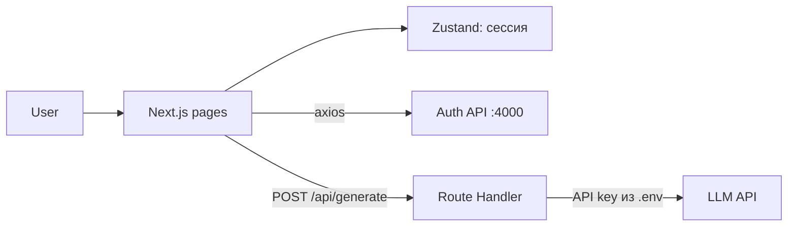

# EducationCollab

Образовательная платформа: пользователь загружает запись урока, а сервис делает из неё конспект, викторину с проверкой ответов и развёрнутые вопросы для самопроверки.


## Возможности

- Лендинг платформы с блоками возможностей и FAQ
- Регистрация и вход (react-hook-form, JWT с автоматическим refresh)
- Личный кабинет: загрузка аудио/видео, генерация конспекта и тестов
- Викторина с подсчётом баллов и пояснениями к ответам
- Ключ LLM-API хранится только на сервере (Next.js Route Handler)

## Архитектура



## Карта проекта

```
education-collab/
├── app/
│   ├── page.tsx                  # Лендинг
│   ├── login/, register/         # Авторизация
│   ├── dashboard/                # Личный кабинет
│   └── api/generate/route.ts     # Серверный прокси к LLM (ключ не попадает в браузер)
└── src/
    ├── auth/
    │   ├── api.ts                # Запросы: login, register, refresh, getAccount
    │   ├── hooks.ts              # useAuthCheck: проверка и обновление сессии
    │   └── store.ts              # Zustand-стор авторизации
    ├── components/
    │   ├── DashboardComponent.tsx  # Загрузка файла, генерация, викторина
    │   ├── LoginForm.tsx, RegisterForm.tsx
    │   ├── Navigation.tsx
    │   └── FeatureItem.tsx
    └── layers/home.tsx           # Секции лендинга
```

## Запуск

```bash
cp .env.example .env.local   # укажи POLZA_API_KEY
npm install
npm run dev                  # http://localhost:3000
```

Для авторизации нужен API-сервер на `http://localhost:4000`.
